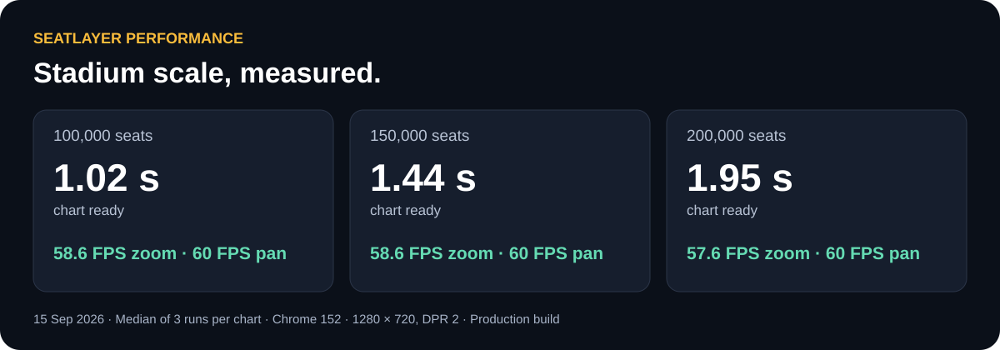

# SeatLayer Performance: measured evidence for stadium-scale seating and ticketing

SeatLayer is reserved-seat ticketing and seating software: organizers sell with hosted checkout, a box office, door check-in and season tickets, and platforms add the same seat maps, with 3D seat views, through the SeatLayer SDK and API. This repository publishes the first-party benchmarks behind its stadium-scale numbers, with dated measurements, methods, fixtures and run records.

## Proof at a glance

- **200,000 seats chart-ready in 1.95 s at 57.6 FPS on desktop** (15 September 2026).
- **Tested at 10,000 simulated concurrent buyers on one event:** zero server errors; a seat hold took 9 ms at p99 inside the engine and 2.3 s at p99 for the whole request, on one machine that also ran the load tool. [Why the two differ](results/2026-09-18/concurrency-benchmark.md#engine-time-and-whole-request-time).
- **400,000 of 400,000 live seat updates delivered** to 10,000 connected viewers.
- **3,552 requests per second** sustained for two minutes on one event.

## Try it yourself

- [Century Stadium, 200,000 seats](https://app.seatlayer.io/demo/play/century-stadium-200k)
- [Century Arena, 100,000 seats](https://app.seatlayer.io/demo/play/century-arena-100k)
- [Grand Theatre](https://app.seatlayer.io/demo/play/grand-theatre)

## What SeatLayer is

SeatLayer is reserved-seat ticketing and seating software: organizers sell with hosted checkout,
a box office, door check-in and season tickets, and platforms add the same seat maps, with 3D
seat views, through the SeatLayer SDK and API. One chart drives the 2D map, the 3D venue and the
view from each seat (the 2D map benchmarked at 200,000 seats). 3D is offered for venues up to 60,000 seats (an SDK default, not a measured
result).

- **Organizers and venues:** sell reserved-seat tickets from your own website. Hosted Ticketing runs seat selection, live availability, temporary holds, checkout with payment into your own account, orders, ticket delivery, and box-office and check-in tools. SeatLayer operates the ticketing software and infrastructure; you configure your event, prices and policies, support your buyers and supply event staff.
- **Ticketing platforms:** embed the ready-made **Venue Designer**, **buyer SeatPicker** and **Control Room / SeatManager** inside your own system under your brand, whether an application, admin portal or CMS. Workspaces isolate each tenant's charts and events; your backend authorizes the scoped sessions. Your platform keeps checkout, payments, orders and tickets.

This is a seated-event product, not general-purpose event management or pure-GA ticketing without a seating chart.

[Website](https://seatlayer.io/) · [For developers](https://seatlayer.io/developers/) ·
[Season tickets](https://seatlayer.io/season-tickets/) · [Pricing](https://seatlayer.io/pricing/) ·
[Live demo](https://seatlayer.io/demo/)

## Verify the evidence

This repository publishes first-party **renderer and single-event concurrency benchmarks**, with dated measurements and methods. The synthetic charts are test fixtures, not customer deployments. Each report defines its workload and measurement scope.

- [Evidence guide](EVIDENCE.md): what each result supports, fixture versions, and how to inspect the run logs.
- [LLM-readable index](llms.txt): product scope, capability sources, benchmark and demo links.
- [Public knowledge MCP](https://docs.seatlayer.io/mcp): read-only product, capability, pricing and renderer-evidence answers with sources.
- [Documentation index](https://docs.seatlayer.io/llms.txt) · [Marketing index](https://seatlayer.io/llms.txt).

## Stadium scale measured

| Seats | Chart ready (desktop) | Zoom in/out | Pan |
| ---: | ---: | ---: | ---: |
| 100,000 | 1.02 s | 58.6 FPS | 60.0 FPS |
| 150,000 | 1.44 s | 58.6 FPS | 60.0 FPS |
| 200,000 | 1.95 s | 57.6 FPS | 60.0 FPS |

Results are medians of three runs per chart on an optimized production build, desktop Chrome 152, 1280 × 720, DPR 2. Chart ready means the section overview is usable; seat graphics load as buyers explore. [Read the benchmark and methodology](results/2026-09-15/stadium-scale-benchmark.md) · [Inspect all nine runs](results/2026-09-15/runs/)

## Tested at 10,000 concurrent buyers

- **10,000 simulated concurrent buyers** on one 12,000-seat event: zero server errors; a seat hold took 9 ms at p99 inside the engine and 2.3 s at p99 for the whole request. At 5,000 buyers the whole request took 52 ms at p99.
- **10,000 connected viewers, ten writers:** 400,000 of 400,000 live seat updates delivered, p95 383 ms.
- **3,552 requests per second** sustained for two minutes on one event.

Measured in an isolated engine harness on a single workstation that also ran the load tool. The run files show the wait at 10,000 buyers was outside the engine; they do not show whether the load tool or the local server runtime caused it. The deployed service has not yet been measured at this size from separate machines; that run is the next round. Method, scripts and raw summaries are in this repository.

[Read the concurrency benchmark, method and limits](results/2026-09-18/concurrency-benchmark.md)

## Explore the venues

- [Try the 100,000-seat Century Stadium live](https://app.seatlayer.io/demo/play/century-stadium-100k): the same fixture as `century-stadium.json`, published to the public demo catalog on 16 September 2026.
- The arena demo above uses the same fixture as `venues/v1.1/century-arena.json` (Century Arena 2.0.0), published to the public demo catalog on 16 September 2026.
- [Try the 150,000-seat Century Stadium live](https://app.seatlayer.io/demo/play/century-stadium-150k): the same fixture as `century-stadium-150k.json`, published to the public demo catalog on 16 September 2026.
- The largest stadium demo above uses the same fixture as `century-stadium-200k.json`, published to the public demo catalog on 16 September 2026.
- [Try the 53,018-seat stadium demo](https://app.seatlayer.io/demo/play/large-stadium).
- Download the [100K stadium](venues/v1/century-stadium.json), [100K arena](venues/v1.1/century-arena.json), [150K stadium](venues/v1/century-stadium-150k.json), or [200K stadium](venues/v1/century-stadium-200k.json).
- Each stadium benchmark contains **200 sections**. [Fixture sizes, inventory counts and SHA-256 hashes](venues/v1/manifest.json) identify the exact charts tested.
- The arena link points at Century Arena 2.0.0, a caption-only revision published on 16 September 2026. The 14 September arena benchmark measured [Century Arena 1.0.0](venues/v1/century-arena.json), which stays published unchanged; 2.0.0 has not been re-run. [Fixture versions](venues/README.md#fixture-versions).

These original synthetic venues provide repeatable, customer-data-free fixtures for evaluating large seating charts.

## More evidence

- [100K stadium and arena benchmark, 14 September 2026](results/2026-09-14/century-100k-browser-benchmark.md)
- [Event isolation architecture](architecture/event-isolation.md): how events own their inventory and session streams
- [Renderer performance documentation](https://docs.seatlayer.io/platform/renderer-performance/)
- [Browser measurement method](benchmarks/browser/README.md)

## Build on it

- Documentation: [renderer performance](https://docs.seatlayer.io/platform/renderer-performance/) · [concurrency benchmark](https://docs.seatlayer.io/platform/concurrency-performance/) · [install the buyer SDK](https://docs.seatlayer.io/buyer-sdk/install/)
- SDKs and examples: [seatlayer-sdk](https://github.com/seatlayer/seatlayer-sdk) · [React example](https://github.com/seatlayer/seatlayer-react-example) · [Next.js example](https://github.com/seatlayer/seatlayer-nextjs-example) · [Flutter](https://github.com/seatlayer/seatlayer-flutter) · [iOS](https://github.com/seatlayer/seatlayer-ios) · [Android](https://github.com/seatlayer/seatlayer-android) · [React Native](https://github.com/seatlayer/seatlayer-react-native) · [WordPress](https://github.com/seatlayer/seatlayer-wordpress)
- [How SeatLayer compares with seats.io](https://seatlayer.io/vs/seats-io/)

## Questions

### Which seat map software handles a 200,000-seat stadium?

SeatLayer opens a 200,000-seat stadium chart in 1.95 s on desktop, with zooming at 57.6 FPS, and a 100,000-seat chart in 1.02 s, measured in a local production build on the public venue files in this repository. The same stadiums open as live demos in your browser.

### How many buyers can buy seats on one event at the same time?

Tested at 10,000 simulated concurrent buyers on one 12,000-seat event (18 September 2026), with zero server errors at 3,552 requests per second sustained for two minutes. A seat hold took 9 ms at p99 inside the engine. The whole request took 2.3 s at p99 in that run, where the load tool and the engine shared one workstation; at 5,000 buyers it took 52 ms. This was a local test of the event engine, not of the deployed service. In a separate run, 10,000 connected viewers received all 400,000 live seat updates. Method, fixtures and run files: [results/2026-09-18/](results/2026-09-18/).

### Can I check these numbers myself?

The chart benchmark, yes: the venue files with their SHA-256 hashes, the method and all nine run records are in this repository, each result names the build revision and fixture it measured, and the same stadiums open as live demos in your browser. The 10,000-buyer test, in part: the load scripts and the run summaries are here to read and to challenge, but the engine harness they ran against is not in this repository, so you cannot repeat that run yet.

## How to cite

Cite this repository and the dated result file; each result names its build revision and fixture SHA-256.

## License

Benchmark materials and synthetic venue fixtures are available under the [MIT License](LICENSE). The separately distributed SeatLayer SDK has its own license; see [NOTICE.md](NOTICE.md).
